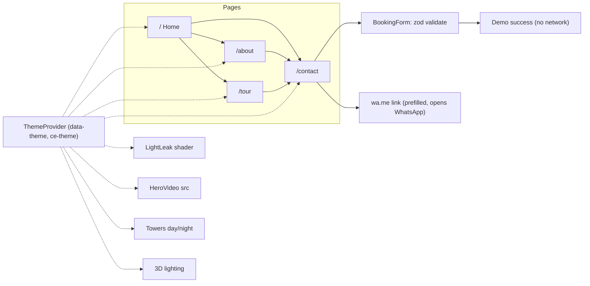

# City Escapes Website Implementation Plan

> **For agentic workers:** REQUIRED SUB-SKILL: Use superpowers:executing-plans to implement this plan task-by-task. Steps use checkbox (`- [ ]`) syntax for tracking.

**Goal:** A dark-luxury, day/night-switchable portfolio concept site for City Escapes with a cinematic home page, a dawn-to-dusk scroll story, and a real-time 3D walkthrough of Residence 12A.

**Architecture:** A static Next.js App Router site (no backend, no database). Every page is a server component shell; motion, the shader, video and 3D live in small client islands that lazy-load. Day/night is a `data-theme` attribute on `<html>` that swaps the CSS token set, the media sources and the shader palette.

**Tech Stack:** Next.js 16.4 · React 19.3 · TypeScript · Tailwind CSS 4.3 · GSAP 3.15 + ScrollTrigger (`@gsap/react` 2.1) · Lenis 1.3 · motion 14 · three 0.187 + @react-three/fiber 9.8 + @react-three/drei 10.7 · zod 4 · Vitest 5 + Testing Library · Playwright 1.65 · Node 22.

**Spec:** `docs/BRIEF.md`, `docs/DESIGN-TOKENS.md`, `docs/ASSETS.md`, `public/media/README.md`

## How we work (user workflow)
Each task ends with a **zip** of the new/changed files that the user extracts over the project folder, followed by the exact `git add / commit / push` commands. Nothing is pushed or deployed for the user.

## Global Constraints
- Credit: "Pablo Chomcobar". Footer copy, exactly: `Concept project by Pablo Chomcobar. Not a real development. Visuals generated with AI.`
- Brand voice: quiet, sentence case, no exclamation marks, no "world-class / luxury redefined / unparalleled".
- Facts: 2 towers · 24 floors · 3 & 4 BHK · SG Highway, Ahmedabad · under construction · sample flat ready · "Price on request" · flat name "Residence 12A".
- Tagline: `Your escape, within the city.`
- Fonts: Cormorant Garamond 400/400 italic + Manrope 400/500 via `next/font/google` only.
- Night tokens: as in `docs/DESIGN-TOKENS.md`. Day tokens: background `#F3EDE3`, background-secondary `#EAE2D5`, background-tertiary `#E0D6C6`, foreground `#1A1714` (15.3:1), foreground-secondary `#4A433A` (8.4:1), foreground-subtle `#6B6154` (5.2:1), brand `#7E6034` (5.0:1), brand-accent `#8F5818`, error `#A3402F`.
- Default theme: night. Persist the choice in `localStorage` key `ce-theme`. No flash of the wrong theme.
- Every animation respects `prefers-reduced-motion: reduce` (fades only, no shader animation, video replaced by its poster, no Lenis).
- Only assets from `public/media` (user-owned), CC0 3D models/HDRIs (Poly Haven, Kenney), OFL fonts. Each CC0 source is listed in `public/models/CREDITS.md`.
- No backend, no API keys, no paid services. The booking form never sends data; its success state says: `This is a concept, so no request was sent.`
- Performance budget: home LCP ≤ 2.5 s on 4G, JS on the home route ≤ 200 KB gzipped (three.js only loads on `/tour`), 60 fps scroll on a mid-range laptop.

## Review Focus
1. **Theme flash on first load / hard refresh:** a stored `day` must render day on the first paint. Test: Playwright, set localStorage `ce-theme=day`, reload, assert `html[data-theme=day]` before hydration (Task 2).
2. **Reduced motion:** with reduced motion on, nothing pins, the shader is static and the hero shows the poster with no video element playing. Test: Playwright `reducedMotion: 'reduce'` (Tasks 5, 7).
3. **Phone portrait:** the pinned horizontal story becomes a vertical stack under 768 px, and the hero uses the vertical video. Test: Playwright at 390×844 (Tasks 5, 7).
4. **Booking form junk input:** an empty name, a phone with letters, a past date, or 2,000-character input all show inline errors, and nothing is "sent". Test: Vitest on `bookingSchema` plus Testing Library on the form (Task 10).
5. **No WebGL** (old phones, blocked GPU): the shader falls back to a CSS gradient, and `/tour` shows a photo-tour fallback instead of a blank canvas. Test: Vitest with `getContext` stubbed to null (Tasks 4, 11).

---

## Site map and data flow (archify-style, Mermaid)


## Key decisions (ADR summary)
| # | Decision | Why |
|---|---|---|
| 1 | Static Next.js, no backend | Concept site; nothing to secure server-side; free Vercel hosting |
| 2 | GSAP ScrollTrigger for pinned/scrubbed scroll; motion for component micro-interactions | GSAP is the most reliable at pinning plus scrub; motion is lighter for hover/press |
| 3 | Lenis smooth scroll, synced to the GSAP ticker | One RAF loop, no jitter |
| 4 | Custom 1-pass fragment shader on a raw WebGL canvas (no three.js on non-tour pages) | Saves ~150 KB on home |
| 5 | Walkthrough: R3F + drei `PointerLockControls` / `KeyboardControls`; collisions by clamping to room rectangles (no physics engine) | A flat is axis-aligned boxes; a physics lib is overkill |
| 6 | Furniture: Kenney Furniture Kit (CC0) GLBs plus Poly Haven 1K HDRI (CC0), Draco-compressed | Free, licensed, small |
| 7 | Extra UI pieces are hand-built (grain, text scramble, magnetic button, cursor ring, image trail) rather than installed from React Bits | Each is under 60 lines; avoids copy-paste kits and extra dependencies |
| 8 | Day/night via `data-theme` + CSS variables; an inline head script sets it before paint | No flash, no client-side re-render of the whole tree |

## File structure
```
app/
  layout.tsx            fonts, <ThemeScript/>, providers, Nav, Footer, grain
  globals.css           Tailwind import, @theme tokens, [data-theme=day] overrides
  page.tsx              Home (composes sections)
  about/page.tsx · contact/page.tsx · tour/page.tsx · not-found.tsx
  opengraph-image.tsx
components/
  theme/ThemeScript.tsx · ThemeProvider.tsx · ThemeToggle.tsx
  layout/Nav.tsx · MobileMenu.tsx · Footer.tsx · Wordmark.tsx
  motion/SmoothScroll.tsx · Reveal.tsx · SplitWords.tsx · MagneticButton.tsx · CursorRing.tsx · TextScramble.tsx · ImageTrail.tsx · Grain.tsx
  bg/LightLeak.tsx · lightLeak.frag.ts
  home/Hero.tsx · HeroVideo.tsx · Intro.tsx · Towers.tsx · DawnToDusk.tsx · Residences.tsx · StepInside.tsx · Materials.tsx · Progress.tsx · CtaBand.tsx
  contact/BookingForm.tsx · WhatsAppButton.tsx · LocationMap.tsx
  tour/TourCanvas.tsx · Flat.tsx · Player.tsx · Hotspots.tsx · TourHud.tsx · TourFallback.tsx
lib/
  theme.ts · booking.ts · whatsapp.ts · flat-layout.ts · collision.ts · content.ts · useReducedMotion.ts
public/media/** (done) · public/models/** · public/hdri/**
tests/unit/*.test.ts(x) · tests/e2e/*.spec.ts
next.config.ts (headers/CSP) · vitest.config.ts · playwright.config.ts · .env.example
```

---

### Task 1: Scaffold, tokens, test harness
**Files:** Create `package.json`, `next.config.ts`, `tsconfig.json`, `postcss.config.mjs`, `app/layout.tsx`, `app/globals.css`, `app/page.tsx` (temporary token swatch page), `vitest.config.ts`, `playwright.config.ts`, `tests/e2e/smoke.spec.ts`, `.gitignore`, `.env.example`.
**Interfaces:** Produces the Tailwind utilities `bg-background`, `text-foreground`, `text-brand`, `font-display`, `text-hero01 … text-caption02`, `py-section`, `px-gutter`, `max-w-site`, `ease-luxe`, plus CSS variables that switch under `html[data-theme="day"]`.
- [ ] Step 1: The Task 1 zip contains the full scaffold, with exact pinned versions, built and verified on my side first. The user extracts it into the existing folder (`docs/` and `public/media/` stay untouched) and runs `npm install`, then `npx playwright install chromium` (create-next-app isn't used because it refuses non-empty folders).
- [ ] Step 2: Test `smoke.spec.ts`: `/` returns 200; `getComputedStyle(body).backgroundColor === 'rgb(14, 13, 11)'`; after `document.documentElement.dataset.theme='day'` it is `rgb(243, 237, 227)`.
- [ ] Step 3: Run `npx playwright test smoke`. It fails (default Next page).
- [ ] Step 4: Implement the `@theme inline` tokens from DESIGN-TOKENS.md and the `[data-theme=day]` overrides from Global Constraints; load the fonts as `--font-cormorant` / `--font-manrope`.
- [ ] Step 5: `npm run build && npx playwright test smoke` → PASS. Zip + commit `chore: scaffold next 16, tokens, tests`.

### Task 2: Day/night theme system
**Files:** `components/theme/*`, `lib/theme.ts`, `tests/unit/theme.test.ts`, `tests/e2e/theme.spec.ts`.
**Interfaces:** Produces `type Theme = 'day' | 'night'`; `readStoredTheme(): Theme` (default `'night'`, ignores invalid values); `useTheme(): { theme: Theme; setTheme(t: Theme): void; toggle(): void }`; a `ce:theme` CustomEvent fired on change (for the shader and the 3D scene); `<ThemeToggle/>` (sun/moon, `aria-pressed`, label "Switch to day" / "Switch to night").
- [ ] Unit tests: an invalid stored value → `'night'`; `toggle()` flips and writes `ce-theme`.
- [ ] e2e (Review Focus 1): a stored day renders day on the first paint; the toggle click changes `data-theme` and survives a reload.
- [ ] Implement: `ThemeScript` is an inline `<script>` in `<head>` (≤ 300 bytes) that reads storage and sets the attribute; the root `<html>` gets `suppressHydrationWarning`. Colour change: `transition: background-color 800ms var(--ease-cinema), color 800ms` on `body`; none under reduced motion.
- [ ] Pass → zip → commit `feat: day/night theme`.

### Task 3: Layout shell and micro-interactions
**Files:** `components/layout/*`, `components/motion/{SmoothScroll,MagneticButton,CursorRing,TextScramble,Grain}.tsx`, `lib/useReducedMotion.ts`, `tests/unit/nav.test.tsx`.
**Interfaces:** `useReducedMotion(): boolean`; `<MagneticButton href strength=0.3>`; `<TextScramble text>` (runs on hover/focus, 400 ms, chars `ABCDEFGHIJKLMNOPQRSTUVWXYZ`); `<SmoothScroll>` (exposes `window.__lenis` only in dev).
- [ ] Tests: the nav has the links Residence (`/#residences`), Tour (`/tour`), About (`/about`), and Book a visit (`/contact`); the mobile menu opens and closes, Esc closes it and focus returns to the trigger; the footer contains the exact Global Constraints copy.
- [ ] Implement: a transparent nav that gains a `backdrop-blur` background after 40 px of scroll and hides on scroll-down and shows on scroll-up (motion); a full-screen mobile menu with staggered links; Grain is a fixed SVG `feTurbulence` overlay at opacity 0.06 (night) / 0.04 (day), `pointer-events:none`; CursorRing only on `(pointer:fine)`; Lenis `lerp 0.1`, disabled under reduced motion.
- [ ] Pass → zip → commit `feat: layout shell`.

### Task 4: Light-leak background shader
**Files:** `components/bg/LightLeak.tsx`, `components/bg/lightLeak.frag.ts`, `tests/unit/lightleak.test.tsx`.
**Interfaces:** `<LightLeak />` (fixed, z-index −1). Reads `--ll-a`, `--ll-b`, `--ll-c` CSS colours plus a `uTime01` (0–1 time of day) set through `setLightLeakTime(t: number)` (exported, used by Task 7).
- [ ] Test (Review Focus 5): with `HTMLCanvasElement.prototype.getContext` → null, the component renders a `div[data-fallback="gradient"]`.
- [ ] Implement: a 2-triangle fullscreen pass; 2–3 soft drifting radial blobs plus a subtle film-grain term; DPR capped at 1.5, rendered at 0.5× resolution and upscaled; paused when `document.hidden` and under reduced motion (one static frame). Theme change lerps the colours over 1.2 s. Night: `#B8935A`/`#4A2C1A`/`#10151D`; day: `#E8D3B0`/`#F3EDE3`/`#CDBFA6`.
- [ ] Pass → zip → commit `feat: light-leak shader background`.

### Task 5: Home hero
**Files:** `components/home/{Hero,HeroVideo}.tsx`, `components/motion/SplitWords.tsx`, `tests/e2e/hero.spec.ts`.
**Interfaces:** `heroSources(theme: Theme, portrait: boolean): { mp4: string; poster: string }`. Night portrait → `/media/video/hero-night-vertical.mp4`; day portrait → day landscape, `object-fit: cover` (no vertical day clip). Exported from `lib/content.ts`.
- [ ] Unit test `heroSources` for all 4 combinations.
- [ ] e2e: at 390×844 night the video src contains `vertical`; with reduced motion there is no playing `<video>`, only the poster `` (Review Focus 2/3).
- [ ] Implement: a full-viewport video (`muted playsInline loop preload="metadata"`, paused by IntersectionObserver when off-screen) with a dark/linen gradient scrim at the bottom 40%. The headline "Your escape, / *within the city.*" reveals word by word (GSAP, 0.08 s stagger, `y:110% → 0`, 1.1 s `ease-luxe`) after the poster paints. Sub-line: `3 & 4 BHK residences · SG Highway, Ahmedabad`. Scroll cue: "Scroll" plus `01 / 08`. A theme switch crossfades the two video elements over 1 s.
- [ ] Pass → zip → commit `feat: hero`.

### Task 6: Towers section with the lights-on switch
**Files:** `components/home/Towers.tsx`, `tests/unit/towers.test.tsx`.
**Interfaces:** Consumes `useTheme`. Layers: `towers-day.webp`, `towers-bluehour.webp`, `towers-night.webp`, `towers-lights-on.mp4` (night loop).
- [ ] Test: with theme day only the day layer is visible; with night the night layer is visible; facts render: `02 Towers`, `24 Floors`, `3 & 4 BHK`, `SG Highway`.
- [ ] Implement: on night, day→blue hour crossfades (600 ms), then night is revealed by a `clip-path: inset(100% 0 0 0) → inset(0)` wipe from the bottom (1.6 s, `ease-cinema`), so the floors light up bottom-up; then the night loop video fades in. Day reverses with a plain 800 ms crossfade. Scroll: the image scales 1.15 → 1 (scrub). The fact numbers count up when entering the viewport.
- [ ] Pass → zip → commit `feat: towers day/night`.

### Task 7: Dawn → Dusk pinned story
**Files:** `components/home/DawnToDusk.tsx`, `tests/e2e/story.spec.ts`.
**Interfaces:** Consumes `setLightLeakTime`. Content array in `lib/content.ts`: `{ time: '6:40 am', room: 'Living room', line: 'Mornings, unhurried.', img }`, `{ '12:10 pm', 'Kitchen', 'Light, from three sides.' }`, `{ '5:50 pm', 'Master bedroom', 'The day, slowing down.' }`, `{ '9:00 pm', 'Balcony', 'The city stays outside.' }`.
- [ ] e2e: on desktop the section pins and the 4th panel is visible after scrolling 3 viewport-widths; at 390 px wide there is no pin and the 4 panels stack (Review Focus 3); reduced motion → no pin.
- [ ] Implement: GSAP `matchMedia` with `(min-width:768px) and (prefers-reduced-motion:no-preference)` → pin, `xPercent -300` scrub 1, `end: +=300%`; a progress rail plus a clock label; each image has inner parallax (`xPercent ±8`); story progress → `setLightLeakTime(progress)`. The ImageTrail cursor is active over this section on desktop.
- [ ] Pass → zip → commit `feat: dawn to dusk story`.

### Task 8: Home lower sections
**Files:** `components/home/{Intro,Residences,StepInside,Materials,Progress,CtaBand}.tsx`, `components/motion/{Reveal,ImageTrail}.tsx`, `tests/unit/home-sections.test.tsx`.
- [ ] Tests: Residences shows `3 BHK` and `4 BHK` with "Price on request" and a fallback placeholder when `residence-4bhk` is missing; the Progress timeline renders 5 milestones (Foundation ✓, Structure ✓, Facade — in progress, Interiors, Possession: Dec 2028); StepInside links to `/tour`.
- [ ] Implement: Reveal = masked image reveal (`clip-path` inset 0 0 100% 0 → 0, 1.2 s) plus 24 px text rise; Materials = 3 square tiles (oak, travertine, brass) with spec captions; CtaBand = full-width "Visit on your terms." with the MagneticButton "Book a visit". Intro uses the `hero02` serif with one brass italic word.
- [ ] Pass → zip → commit `feat: home sections`.

### Task 9: About page
**Files:** `app/about/page.tsx`, `tests/e2e/pages.spec.ts` (shared).
- [ ] e2e: `/about` has an h1 `The idea`, the construction image, the Progress timeline (reused), and a CTA to `/contact`.
- [ ] Implement sections: The idea (manifesto, 3 short paragraphs) · Architecture and light (`about-architecture` or a placeholder) · Materials (reuse) · Progress (reuse) · CtaBand. Metadata title `About · City Escapes`.
- [ ] Pass → zip → commit `feat: about page`.

### Task 10: Contact page and booking form
**Files:** `app/contact/page.tsx`, `components/contact/*`, `lib/booking.ts`, `lib/whatsapp.ts`, `tests/unit/booking.test.ts`, `tests/unit/whatsapp.test.ts`, `tests/unit/form.test.tsx`.
**Interfaces:** `bookingSchema` (zod): `name` 2–60 chars, letters/spaces/.'-; `phone` an Indian mobile `^(\+91)?[6-9]\d{9}$` after stripping spaces; `day` a date ≥ today and ≤ today + 60 days; `slot` `'morning' | 'evening'`; `flat` `'3bhk' | '4bhk'`. `buildWhatsAppUrl(number: string, b?: Partial<Booking>): string` → `https://wa.me/<digits>?text=<encoded>`. Number from `NEXT_PUBLIC_WHATSAPP_NUMBER` (in `.env.example` as `91XXXXXXXXXX`).
- [ ] Unit tests (Review Focus 4): each invalid case listed above fails with its own message; a 2,000-character name fails; a valid booking passes; the URL encodes `&`, `#` and newlines correctly.
- [ ] Form test: submitting empty shows 3 inline errors linked with `aria-describedby`; a valid submit shows the exact demo copy and calls no `fetch`.
- [ ] Implement: a 5-field form, a "Visit on your terms" intro, a slot picker as pill radio buttons, a WhatsApp button that prefills from the current form values, and LocationMap as a hand-drawn SVG (no map API).
- [ ] Pass → zip → commit `feat: contact and booking`.

### Task 11: 3D walkthrough `/tour`
**Files:** `app/tour/page.tsx`, `components/tour/*`, `lib/flat-layout.ts`, `lib/collision.ts`, `public/models/*.glb`, `public/hdri/*.hdr`, `public/models/CREDITS.md`, `tests/unit/collision.test.ts`, `tests/unit/hotspots.test.ts`, `tests/e2e/tour.spec.ts`.
**Interfaces:** `type Room = { id: 'living'|'kitchen'|'bedroom'|'balcony'; x: number; z: number; w: number; d: number; spawn: [number, number, number]; info: { title: string; size: string; features: string[] } }`; `FLAT: Room[]` (living 7×5.5 m, kitchen 4×3.5, bedroom 4.5×4, balcony 6×2.2; ceiling 3.2 m, double height 6.4 m in living); `doors: { a: Room['id']; b: Room['id']; x: number; z: number; w: number }[]`; `clampToFlat(p: {x:number;z:number}, r = 0.3): {x:number;z:number}` keeps the player inside the union of rooms plus door gaps; `nextHotspot(current, target): { path: Room['id'][] }`.
- [ ] Unit tests: a point inside the living room is unchanged; a point through a wall is clamped to the wall minus 0.3; passing through a door gap is allowed; the hotspot path living→bedroom goes via the door.
- [ ] e2e: `/tour` shows a loading screen with a percentage, then the canvas; with `getContext` stubbed to null `TourFallback` renders the 4 story photos (Review Focus 5); the home bundle has no `three` chunk (`page.on('request')` check).
- [ ] Implement: `dynamic(() => import('./TourCanvas'), { ssr:false })`; walls, floors and ceilings are boxes with oak/travertine/linen materials (PBR, 1K textures from Poly Haven CC0); furniture is Kenney GLBs (sofa, bed, island, chairs, lamp) with Draco; the HDRI env plus 1 directional "sun" and 3 warm point lights. Theme → day: sun on, HDRI intensity 1; night: sun off, warm lamps on, city backdrop plane uses the `story-balcony-night` image. Desktop: click "Step inside" → PointerLock, WASD + mouse, 1.6 m eye height, speed 2.2 m/s, `clampToFlat` each frame. Mobile: glowing hotspot discs; a tap glides the camera (1.4 s) along the `nextHotspot` path, plus a drag-to-look. HUD: room name, info card, controls hint, "Book a visit" exit. Budget: ≤ 6 MB total assets, ≤ 150 draw calls, `frameloop="demand"` when idle.
- [ ] Pass → zip → commit `feat: 3d walkthrough`.

### Task 12: Hardening, SEO basics, polish
**Files:** `next.config.ts`, `app/not-found.tsx`, `app/opengraph-image.tsx`, `app/robots.ts`, `app/sitemap.ts`, `tests/e2e/headers.spec.ts`.
- [ ] e2e: the response has `Content-Security-Policy` (`default-src 'self'; img-src 'self' data: blob:; media-src 'self'; script-src 'self' 'unsafe-inline'` for the theme script; `connect-src 'self'`; `frame-ancestors 'none'`), `X-Content-Type-Options: nosniff`, `Referrer-Policy: strict-origin-when-cross-origin`, `Permissions-Policy: camera=(), microphone=(), geolocation=()`, and HSTS. The 404 page renders the "Book a visit" link.
- [ ] `npm audit --omit=dev` shows 0 high; lockfile committed; `.env` git-ignored, only `.env.example` in the repo.
- [ ] Run the full `npx vitest run && npx playwright test` → all green; Lighthouse on `/` ≥ 90 for Performance, Accessibility and Best Practices.
- [ ] Zip → commit `chore: hardening and polish`. Stages 5–7 (deep security review, QA, launch) follow after this plan.

---

## Security plan (light, because the site has no backend)
Static hosting only: there's no server, database, login or stored data. The risks are the browser and dependencies: strict CSP and headers (Task 12), all form input validated by zod and only ever placed in an encoded `wa.me` URL (Task 10), no `dangerouslySetInnerHTML` except the fixed theme script, dependencies pinned with a lockfile and audited, and no secrets anywhere (the WhatsApp number is public by nature).
